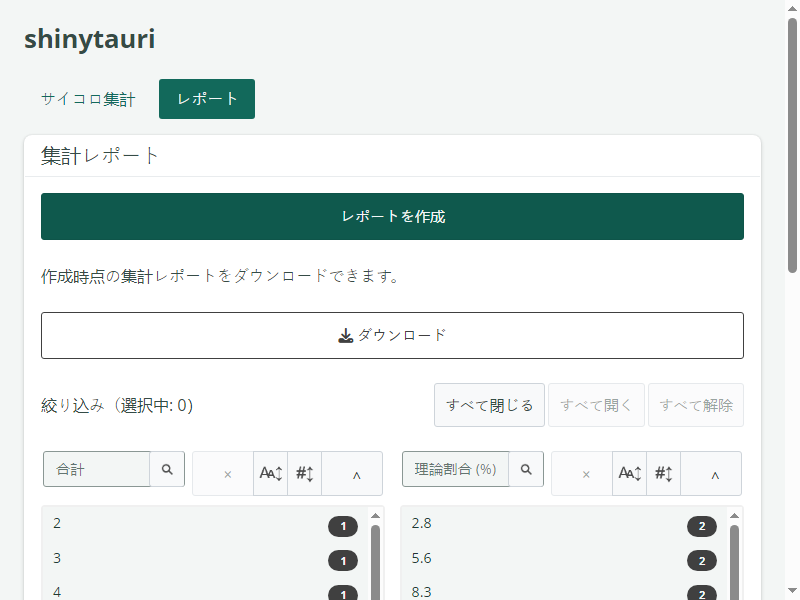

# shinytauri 

shinytauri は R の [Shiny](https://github.com/rstudio/shiny) アプリを Windows x64 用のインストーラーにまとめる CLI である。既存のプロジェクトで実行すると、アプリ、ポータブル R、実行に使う R パッケージを同梱した `*-setup.exe` ができる。配布先では [Tauri®](https://github.com/tauri-apps/tauri) のウィンドウにアプリが開く。

[利用マニュアル](https://hkrkizum.github.io/shinytauri/) · [リリース](https://github.com/hkrkizum/shinytauri/releases) · [開発に参加する](docs/development.qmd)



Rhino デモではサイコロの集計結果を絞り込み、レポートを HTML で保存できる。[デモを動かす](docs/demo.qmd)

## インストール

ビルド機に合う x86_64 用のアーカイブを [GitHub Releases](https://github.com/hkrkizum/shinytauri/releases) から取得する。展開した `shinytauri`（Linux）または `shinytauri.exe`（Windows）を PATH の通ったディレクトリに置く。ソースからインストールする場合はリポジトリのルートで `cargo install --locked --path cli` を実行する。

| ビルド機 | 必要な環境 |
| --- | --- |
| Linux x86_64 | Git、flakes と `nix-command` を有効にした Nix |
| Windows x64 | Visual Studio Build Tools の C++ ツールと Windows SDK、Rust の MSVC ツールチェーン、rig、Tauri CLI |

CLI を導入したら `shinytauri doctor` でビルド機のツールを確認する。不足があれば、診断結果に導入手順が表示される。

ビルドにはインターネット接続が必要である。配布先は WebView2 Runtime を導入した Windows 10/11 x64 で、R を別途インストールする必要はない。[OS 別の導入手順](docs/installation.qmd)

## 最初のビルド

次は `app.R` で Shiny だけを使うアプリの例である。初回に配布設定を作り、同梱の最小ロックを使ってビルドする。

```sh
cd sales-dashboard
shinytauri init . --id jp.example.sales-dashboard
shinytauri inspect .
shinytauri build .
```

`inspect` は配布するファイルと、同梱する R のバージョンやパッケージ数を表示する。たとえば `app.R` で `source("helpers.R")` を呼ぶ場合は、`helpers.R` も `shinytauri.toml` の `files` に含める。新しい画像や CSS を追加したときも配布対象を確認する。`build` が `dist/` に作成した `*-setup.exe` を利用者に渡す。アプリの変更を配布するときは再度ビルドする。

`DT` などを使う場合は `--package` で依存を宣言する。`renv.lock` や `DESCRIPTION` を使っている場合は、それらをもとに `shinytauri lock .` で Windows 用ロックを作成できる。既存の rig プロジェクトは Windows 用の `rproj.lock` を再利用できる。[アプリの依存パッケージ](docs/dependencies.qmd)

依存定義のないアプリで配布用 R を固定するには、初期化時に `--r-version 4.5.3` を指定し、`shinytauri lock .` と `shinytauri build .` を実行する。既存の `renv.lock` や rig の Windows 用ロックが R を指定している場合は、そのバージョンを使える。[同梱する R の選び方](docs/dependencies.qmd)

動くアプリのコードから試すには[はじめてのビルド](docs/index.qmd)、同梱するファイルや製品名を変えるには[配布設定のリファレンス](docs/configuration.qmd)を参照する。

## 謝辞

ポータブル R とアプリに必要な R パッケージをビルド時にまとめ、配布先でそのまま使えるようにする設計は、James Joseph Balamuta による [shinyelectron](https://github.com/coatless-rpkg/shinyelectron) の配布方式から着想を得た。

## ライセンス

shinytauri 自身のコードと既定アイコンは [MIT License](LICENSE) で配布する。CLI の依存ライブラリの著作権表示とライセンス本文は配布アーカイブの `notices/` にある。生成したアプリでは `offline/notices/` にホストのライセンス文書と同梱物の一覧が入る。R、パッケージ、アプリの素材にはそれぞれの配布条件が適用される。[CLI のライセンス表示](https://hkrkizum.github.io/shinytauri/development.html#cli-notices)・[インストーラーの再配布と対応ソース](https://hkrkizum.github.io/shinytauri/distribution.html#redistribution)

リポジトリのロゴ、Quarto マニュアルの本文と自作の図版は CC BY 4.0（表示 4.0 国際）で公開する。マニュアル内のサンプルコードには MIT License が適用される。[マニュアルのライセンス](docs/license.qmd)

shinytauri は独立したプロジェクトである。TAURI は The Tauri Programme within the Commons Conservancy の登録商標である。[Tauri の商標ガイドライン](https://v2.tauri.app/about/trademark/)
